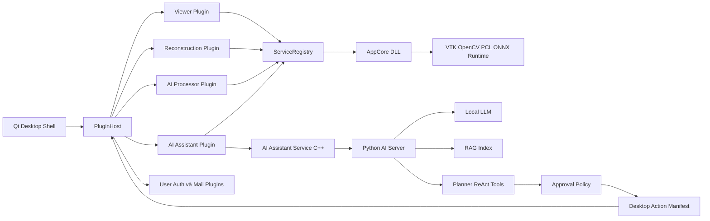

# 3D Reconstruction và AI Assistant

Ứng dụng desktop C++/Qt xây dựng một quy trình từ hiển thị dữ liệu 2D/3D, tái tạo mô hình 3D từ nhiều ảnh, xử lý point cloud, đến suy luận thị giác máy tính và trợ lý AI cục bộ. Hệ thống được tổ chức theo kiến trúc plugin, tách giao diện khỏi các dịch vụ xử lý và cung cấp AI Agent có khả năng lập kế hoạch, truy xuất tri thức bằng RAG, xin phê duyệt và thực thi các chức năng của ứng dụng.

README này tổng hợp yêu cầu trong [Requirement with 3D tools.docx](Docs/Requirement%20with%203D%20tools.docx) và trạng thái hiện tại của source code. Phase 5 và Phase 6 trong yêu cầu ban đầu được thay bằng phạm vi AI Assistant và AI Agent như mô tả trong phần [Kế hoạch triển khai](#kế-hoạch-triển-khai).

## Mục tiêu

- Xây dựng năng lực nội bộ về C++/Qt, xử lý ảnh, dựng hình 3D và AI.
- Cung cấp pipeline tái sử dụng cho hiển thị, tái tạo, xử lý point cloud và suy luận AI.
- Tích hợp trợ lý AI cục bộ để hỗ trợ hỏi đáp và khai thác tài liệu dự án.
- Cho phép AI Agent lập kế hoạch và thực thi có kiểm soát các thao tác trong ứng dụng.
- Duy trì ranh giới module rõ ràng, khả năng kiểm thử và khả năng mở rộng lâu dài.

## Chức năng chính

### Trình xem 2D và 3D

- Nạp và hiển thị ảnh 2D.
- Nạp mô hình 3D và dữ liệu OBJ/MTL; hợp đồng desktop-agent cũng hỗ trợ luồng OBJ, STL và PLY.
- Nạp chuỗi ảnh DICOM và hiển thị volume/MPR.
- Điều khiển camera, zoom, xoay, pan, chuyển ảnh và tự động duyệt ảnh.
- Hiển thị point cloud, bật/tắt kết quả tái tạo và áp dụng thiết lập hiển thị theo người dùng.

### Tái tạo 3D

- Nhận nhiều ảnh chụp từ các góc nhìn khác nhau.
- Phát hiện và ghép đặc trưng bằng OpenCV.
- Ước lượng camera pose và sinh point cloud.
- Chạy tái tạo trên worker riêng, hỗ trợ dừng hợp tác và công bố snapshot kết quả an toàn cho UI.
- Nạp camera parameters, cấu hình mật độ, số lượng feature và chế độ tự làm sạch.
- Hiển thị kết quả point cloud trực tiếp trong scene VTK.

### Xử lý point cloud

- Lọc nhiễu và downsampling bằng PCL.
- Xử lý hậu kỳ point cloud sau tái tạo.
- Tách dữ liệu point cloud khỏi kiểu triển khai cụ thể tại biên plugin.

### AI Computer Vision

- Object detection, instance segmentation và video object tracking.
- Suy luận bằng ONNX Runtime với model detection, segmentation và tracking.
- Điều chỉnh confidence threshold và quản lý trạng thái tracking.
- Chạy inference ngoài GUI thread và chặn exception tại biên dịch vụ.
- Pipeline Python riêng để huấn luyện, kiểm tra chất lượng, export ONNX và ghi provenance vào manifest.

### AI Assistant và AI Agent

- Chat nhiều phiên, đổi tên/xóa phiên, retry hoặc sửa tin nhắn và đính kèm file/ảnh.
- Hỏi đáp bằng LLM cục bộ qua `llama-cpp-python`.
- Trích xuất thông tin từ tài liệu dự án bằng RAG, kết hợp FAISS và BM25.
- Lập kế hoạch, suy luận, phản biện và thực thi theo đồ thị agent.
- Gọi công cụ đọc/ghi file, tìm kiếm source, thao tác hệ thống, VCS và hành động desktop theo chính sách.
- Yêu cầu người dùng phê duyệt trước các hành động có side effect.
- Điều khiển các chức năng ứng dụng thông qua hợp đồng versioned tại `Config/agent_action_manifest.json`.
- Hỗ trợ MCP, A2A, short-term/long-term memory, checkpoint và audit/observability.

Các hành động desktop hiện có bao gồm nạp ảnh/mô hình/DICOM, chạy tái tạo, xem kết quả 3D, detection, segmentation, video tracking, huấn luyện model, mở/đóng Assistant, quản lý mail, đổi ngôn ngữ và các thao tác quản trị người dùng.

## Kiến trúc tổng quan



### Ranh giới chính

- `AppCore.dll` chứa kernel, service và phần xử lý dùng chung.
- Executable chỉ giữ application shell và composition root.
- Plugin chỉ truy cập chức năng qua các interface trong `src/include/` và `ServiceRegistry`.
- SDK nặng như VTK, OpenCV, PCL và ONNX Runtime là dependency private của target cần dùng.
- Plugin nhẹ dùng PCH Qt/STL; plugin có source phụ thuộc SDK nặng dùng heavy PCH.
- Plugin có ABI version và fingerprint tự động dựa trên toolchain, phiên bản SDK và hash bề mặt interface.

## Cấu trúc repository

```text
3D-Reconstruction/
├─ src/
│  ├─ app/                    # Executable shell và composition root
│  ├─ core/                   # Kernel cụ thể, cấu hình, plugin host, bảo mật
│  ├─ include/                # Interface và DTO công khai cho plugin
│  ├─ modules/                # Sáu plugin chức năng
│  ├─ services/               # AI, mail, reconstruction, scene, settings, shell, viewer
│  └─ utils/                  # Tiện ích dùng chung thuộc bề mặt ABI
├─ tests/                     # CTest, architecture, coverage và mutation gates
├─ AIAssistant/               # Python local LLM, RAG, agent, MCP và A2A
├─ AIComputerVision/          # Huấn luyện, đánh giá và export model YOLO sang ONNX
├─ Models/                    # ONNX runtime artifacts qua Git LFS
├─ Config/                    # Cấu hình app và hợp đồng desktop-agent action
├─ Docs/                      # Yêu cầu, kiến trúc, WBS và tài liệu phase
├─ translations/             # Tài nguyên đa ngôn ngữ
└─ CMakeLists.txt             # Build graph chính
```

### Plugin hiện có

| Plugin | Trách nhiệm |
|---|---|
| `ViewerPlugin` | Nạp và điều khiển dữ liệu 2D, 3D, DICOM |
| `ReconstructionPlugin` | UI và workflow tái tạo 3D |
| `AIProcessorPlugin` | Detection, segmentation, tracking và huấn luyện |
| `AIAssistantPlugin` | Chat, RAG, agent, approval và session UI |
| `UserAuthPlugin` | Đăng nhập, tài khoản, profile, license và cài đặt |
| `SendMailPlugin` | Inbox, gửi mail và cấu hình SMTP |

## Công nghệ

| Nhóm | Công nghệ |
|---|---|
| Desktop | C++20, Qt 6, CMake, MSVC |
| 3D | VTK, OpenGL, PCL, Eigen |
| Computer Vision | OpenCV, ONNX Runtime 1.20.1, YOLO |
| Bảo mật | OpenSSL, Windows DPAPI, PBKDF2-HMAC-SHA256 |
| AI Assistant | Python 3.11+, FastAPI, LangGraph, llama.cpp, FAISS, BM25 |
| Kiểm thử | Qt Test, CTest, coverage gate, mutation testing, ruff, mypy |

## Kế hoạch triển khai

Kế hoạch dưới đây giữ nguyên Phase 0–4 của tài liệu yêu cầu. Phase 5 và Phase 6 cũ về tối ưu/refactor và buffer/risk được thay bằng một phạm vi thống nhất kéo dài 8 tuần.

| Phase | Thời lượng | Phạm vi | Kết quả mong đợi |
|---|---:|---|---|
| Phase 0 | 4 tuần | Nghiên cứu Qt/OpenGL, OpenCV, SfM, PCL, ONNX Runtime/TensorRT và cấu hình CMake | Môi trường phát triển và prototype kỹ thuật |
| Phase 1 | 5 tuần | Trình xem 2D/3D, nạp ảnh và mô hình, zoom/rotate/pan | Viewer demo hoạt động |
| Phase 2 | 8 tuần | Feature matching, camera pose và sinh point cloud từ nhiều ảnh | Reconstruction demo cơ bản |
| Phase 3 | 4 tuần | Lọc nhiễu, downsampling và tích hợp PCL | Point cloud được cải thiện |
| Phase 4 | 7 tuần | Detection/segmentation/tracking bằng ONNX Runtime; áp dụng AI vào dữ liệu đầu vào | AI-assisted processing demo |
| Phase 5–6 | 8 tuần | **Triển khai AI Assistant cho phép hỗ trợ người dùng, hỏi đáp, trích xuất thông tin từ RAG; AI Agent cho phép lập kế hoạch và thực thi yêu cầu người dùng liên quan đến các function của ứng dụng** | Chat/RAG demo, agent plan, approval và thực thi chức năng app end-to-end |

### Tiêu chí hoàn thành Phase 5–6

- Người dùng có thể đặt câu hỏi và nhận câu trả lời theo ngữ cảnh phiên chat.
- Assistant truy xuất được nội dung liên quan từ corpus RAG và đưa vào câu trả lời.
- Agent chuyển yêu cầu nhiều bước thành kế hoạch có thể quan sát.
- Agent ánh xạ mỗi thao tác ứng dụng tới một action được khai báo trong manifest.
- Hành động có side effect phải qua policy và phê duyệt của người dùng.
- Kết quả thực thi UI được gửi lại cho agent để tiếp tục hoặc kết thúc kế hoạch.
- Session, attachment, pending action và checkpoint được quản lý theo đúng vòng đời.
- Luồng lỗi, hủy tác vụ và restart model/RAG/agent/server không làm treo GUI.

## Trạng thái hiện tại theo phase

Các trạng thái dưới đây phản ánh thành phần đang hiện diện trong source, không thay cho kết quả của một lần build/test trên máy mới.

| Phase | Thành phần hiện có trong source |
|---|---|
| 0 | CMake, Qt, VTK, OpenCV, PCL, Eigen, OpenSSL và ONNX Runtime đã được tích hợp |
| 1 | Viewer/Scene service, Viewer plugin, 2D/3D/DICOM và tương tác camera |
| 2 | Reconstruction service/pipeline, worker bất đồng bộ và point-cloud snapshot |
| 3 | Point-cloud filter, refinement và PCL processing |
| 4 | Detection, segmentation, tracking, model loading và pipeline huấn luyện/export |
| 5–6 | C++ Assistant plugin/service cùng Python LLM, RAG, agent graph, approval và desktop actions |

## Yêu cầu môi trường

- Windows x64 với Visual Studio 2022 và MSVC developer environment.
- Qt 6.9.3 kit tại `C:/Qt/6.9.3/msvc2022_64` cho cấu hình local được mô tả bên dưới.
- CMake 3.19 trở lên.
- vcpkg đã provision các package trong `vcpkg.json`.
- ONNX Runtime GPU 1.20.1 đã giải nén, với `include/` và `lib/` ở thư mục gốc.
- Python 3.11 trở lên cho `AIAssistant/` và pipeline huấn luyện.
- Model/dataset phù hợp với tác vụ cần chạy.

> **Lưu ý Qt kit:** runtime local nạp Qt từ `C:/Qt/6.9.3/msvc2022_64/bin`. Nếu CMake vô tình link target với Qt trong vcpkg, chương trình có thể lỗi `0xc0000139` hoặc exit code `127`. Luôn cấu hình từ Qt Creator hoặc truyền `QT_QMAKE_EXECUTABLE` như lệnh dưới đây.

## Build ứng dụng C++

Mở MSVC Developer PowerShell hoặc chạy `vcvars64.bat`, sau đó cấu hình bằng Qt kit và dependency đã provision. Build offline không chạy manifest install và không tải ONNX Runtime:

```powershell
$VcpkgRoot = "F:/PROJECTS/QT/vcpkg"
$OnnxRuntimeDir = "F:/PROJECTS/QT/onnxruntime-win-x64-gpu-1.20.1"

cmake -B build -S . -G "Visual Studio 17 2022" `
  -DCMAKE_TOOLCHAIN_FILE="$VcpkgRoot/scripts/buildsystems/vcpkg.cmake" `
  -DVCPKG_INSTALLED_DIR="$VcpkgRoot/installed" `
  -DVCPKG_MANIFEST_INSTALL=OFF `
  -DQT_QMAKE_EXECUTABLE=C:/Qt/6.9.3/msvc2022_64/bin/qmake.exe `
  -DBUILD_TESTING=ON `
  -DFETCHCONTENT_SOURCE_DIR_ONNXRUNTIME="$OnnxRuntimeDir"

cmake --build build --config Release --parallel 2
```

Chạy ứng dụng sau khi build:

```powershell
.\build\Release\3D-Reconstruction.exe
```

Qt plugins, translations, `AppCore.dll` và runtime DLL cần thiết được deploy cạnh executable bởi các bước `POST_BUILD`.

## Cài đặt AI Assistant

Từ thư mục gốc repository:

```powershell
# Runtime Python đã được khóa hash; llama-cpp-python cài riêng theo CPU/CUDA.
pip install --require-hashes -r AIAssistant/requirements.lock
pip install -e AIAssistant

Copy-Item AIAssistant/.env.example AIAssistant/.env
python AIAssistant/scripts/verify_models.py
```

Chọn wheel `llama-cpp-python` phù hợp với phần cứng theo hướng dẫn trong [AIAssistant/README.md](AIAssistant/README.md). Ứng dụng Qt tự khởi động supervisor/server và tự sinh token riêng; chỉ cần chạy server thủ công khi phát triển hoặc chẩn đoán độc lập.

## Huấn luyện và export model

```powershell
pip install -r AIComputerVision/requirements.txt

# Kiểm tra môi trường và dữ liệu
python AIComputerVision/TrainModel.py --check

# Huấn luyện detection và segmentation
python AIComputerVision/TrainModel.py --yes

# Huấn luyện tracking
python AIComputerVision/TrainModel.py --track --yes

# Kiểm tra provenance của model đã export
python AIComputerVision/TrainModel.py --verify-manifest
```

Tên model ONNX phải đồng bộ giữa `AIComputerVision/Models/manifest.json`, thư mục `Models/` và `src/include/AIConstants.h`. Model ONNX là Git LFS artifacts; không commit model weight ngoài Git LFS.

## Kiểm thử

### C++ và kiến trúc

```powershell
cmake -DSOURCE_DIR="$PWD" -P tests/CheckArchitectureBoundaries.cmake
ctest --test-dir build -C Release --output-on-failure
python tests/coverage_gate.py
python tests/mutation_check.py
```

Test suite bao phủ service registry, plugin lifecycle/ABI, UI ownership, viewer, reconstruction, AI inference/model loading, Assistant, bảo mật, mail, user management và hợp đồng desktop-agent action.

### Python AI Assistant

```powershell
Set-Location AIAssistant
ruff check .
python -m compileall -q evals src
python -m mypy src/ai_assistant
$env:PYTHONPATH = "src"
lint-imports --no-logo
python -m coverage run -m unittest discover -s tests -p "test_*.py"
python -m coverage report
python scripts/mutation_check.py
```

### AI Computer Vision

```powershell
Set-Location AIComputerVision
pip install --require-hashes -r requirements-test.lock
ruff check .
python -m mypy
coverage run -m unittest discover -s tests
coverage report
python scripts/mutation_check.py
```

## Quy trình phát triển

1. Thiết kế kiến trúc, class/data flow và review trước khi triển khai.
2. Phát triển tăng dần theo phase, mỗi phase phải có đầu ra chạy được.
3. Review code về ownership, memory, hiệu năng, thread safety và ranh giới module.
4. Chạy test/gate phù hợp trước khi demo hoặc đóng phase.
5. Duy trì WBS cho từng phase và cập nhật trạng thái định kỳ.
6. Demo hằng tuần hoặc tại cuối phase bằng bản build và dữ liệu có thể tái hiện.

## Tiêu chí chất lượng

- Sử dụng C++ hiện đại, smart pointer và RAII.
- Không để blocking I/O hoặc AI inference chạy trên GUI thread.
- Không để exception thoát khỏi Qt slot, `QThread::run()` hoặc biên plugin/service.
- Không để background task sống lâu hơn service/object mà task sử dụng.
- Giữ plugin-facing API trong `src/include/` và `src/utils/`; plugin không include concrete core header.
- Mỗi action của AI Agent có đúng một owner trong plugin layer.
- Thay đổi guard phải có test và mutant pin quyết định tương ứng.
- Tài liệu, số liệu gate và hợp đồng model/action phải được cập nhật cùng code.

## Tài liệu liên quan

- [Yêu cầu dự án](Docs/Requirement%20with%203D%20tools.docx)
- [Kiến trúc C++ và quality gates](Docs/ARCHITECTURE_SRC.md)
- [AI Assistant](AIAssistant/README.md)
- [AI Assistant scorecard](AIAssistant/Docs/SCORECARD.md)
- [AI Computer Vision](AIComputerVision/README.md)
- [AI Computer Vision scorecard](AIComputerVision/Docs/SCORECARD.md)
- [Desktop-agent action manifest](Config/agent_action_manifest.json)
- [Plugin unload lifecycle](Docs/ADR_PLUGIN_UNLOAD_LIFECYCLE.md)

## Kết quả mong đợi

Một ứng dụng desktop có thể nạp và hiển thị dữ liệu 2D/3D, tái tạo point cloud từ ảnh, xử lý và phân tích dữ liệu bằng AI, đồng thời cung cấp AI Assistant/AI Agent cục bộ để hỗ trợ người dùng từ hỏi đáp tài liệu đến lập kế hoạch và thực thi an toàn các chức năng của ứng dụng.
